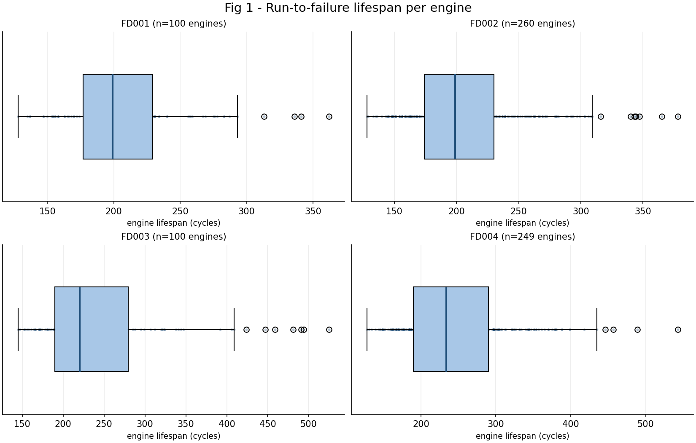
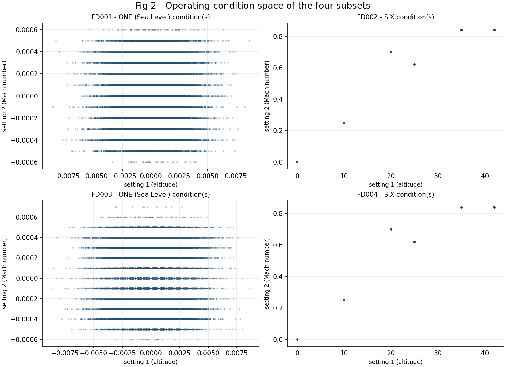
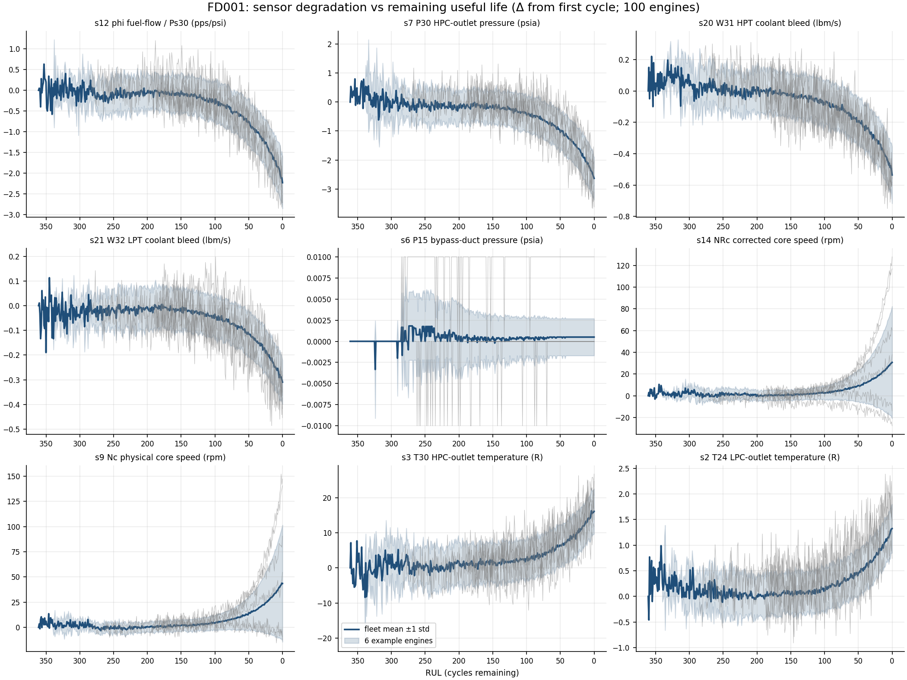
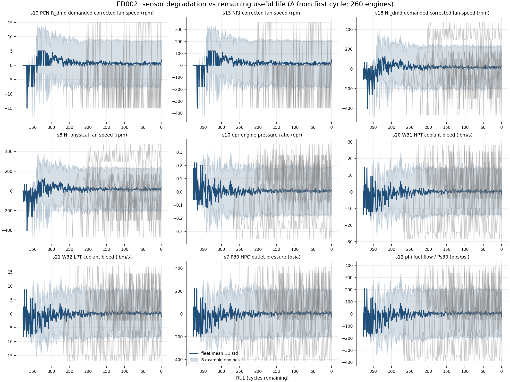
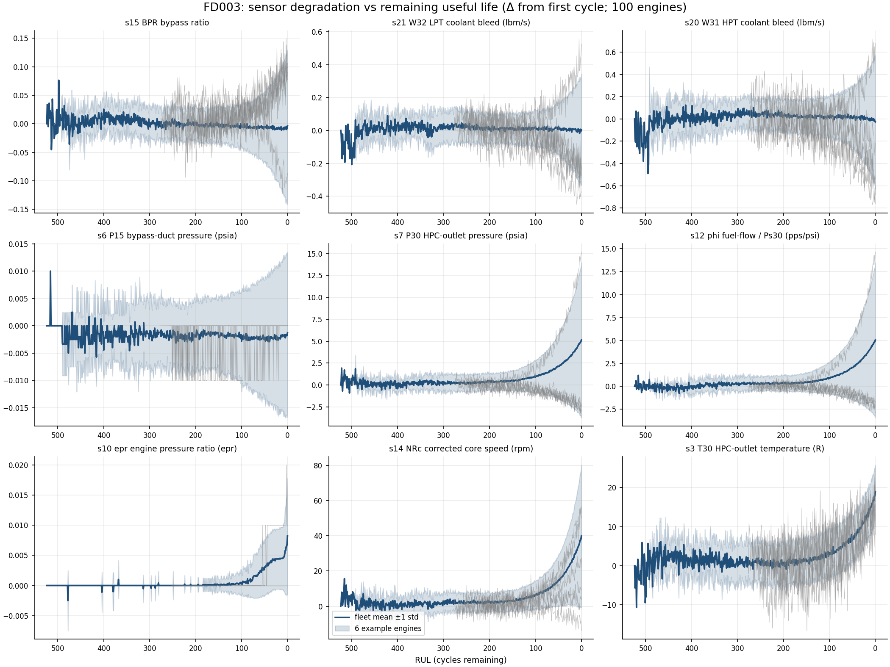
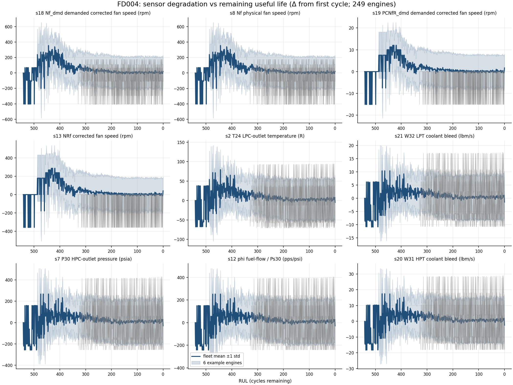
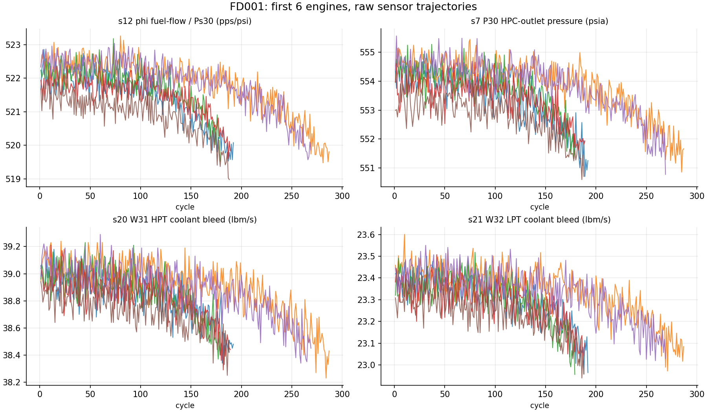
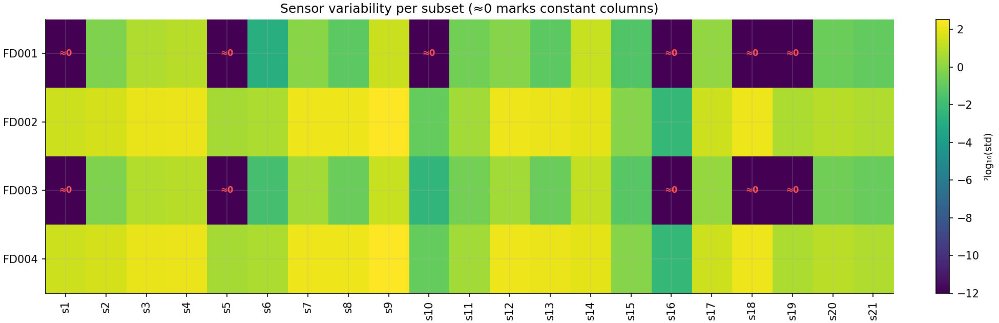
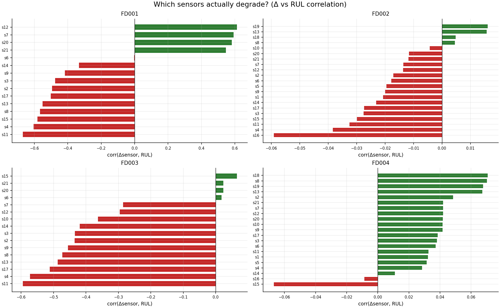
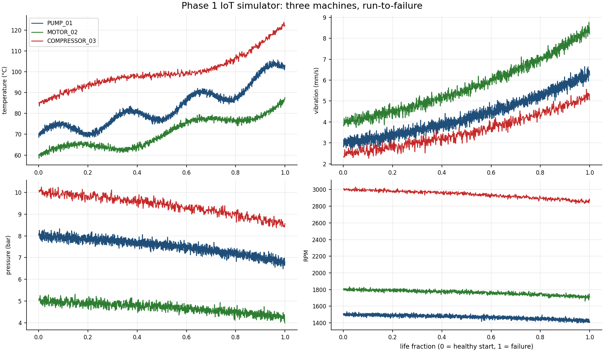

# C-MAPSS exploratory data analysis (Phase 1)

Generated automatically by `python -m predictive_maintenance.eda` on 2026-11-05.
All numbers below are computed from the downloaded dataset - nothing is hand-typed.

## Dataset overview

| dataset | train units | train rows | test units | test rows | conditions | fault modes | lifespan min | lifespan median | lifespan max |
|---|---|---|---|---|---|---|---|---|---|
| FD001 | 100 | 20631 | 100 | 13096 | ONE (Sea Level) | ONE (HPC Degradation) | 128 | 199 | 362 |
| FD002 | 260 | 53759 | 259 | 33991 | SIX | ONE (HPC Degradation) | 128 | 199 | 378 |
| FD003 | 100 | 24720 | 100 | 16596 | ONE (Sea Level) | TWO (HPC + Fan Degradation) | 145 | 220 | 525 |
| FD004 | 249 | 61249 | 248 | 41214 | SIX | TWO (HPC + Fan Degradation) | 128 | 234 | 543 |

Fig 2 (operating-condition space) visualises the *conditions* column.

## Constant (non-informative) sensors

Sensors with zero variance carry no degradation signal; Phase 2's preprocessing
pipeline will drop them per subset before scaling.

| dataset | constant sensors | count |
|---|---|---|
| FD001 | s1, s5, s10, s16, s18, s19 | 6 |
| FD002 | — | 0 |
| FD003 | s1, s5, s16, s18, s19 | 5 |
| FD004 | — | 0 |

## Sensors that degrade (delta vs RUL correlation)

Correlating each sensor's change from its first cycle against engine RUL ranks
channels by degradation informativeness:

| FD001 | FD002 | FD003 | FD004 |
|---|---|---|---|
| s12 (+0.61) | s19 (+0.02) | s15 (+0.07) | s18 (+0.07) |
| s7 (+0.59) | s13 (+0.02) | s21 (+0.02) | s8 (+0.07) |
| s20 (+0.58) | s18 (+0.00) | s20 (+0.02) | s19 (+0.07) |
| s21 (+0.55) | s8 (+0.00) | s6 (+0.02) | s13 (+0.07) |
| s6 (-0.00) | s10 (-0.00) | s7 (-0.29) | s2 (+0.05) |

Sensors in the top-3 for every subset: (none shared by all four).

## Figures

## Methods and caveats

- **RUL** here is *uncapped* (lifespan - cycle) because degradation analysis wants the
  full range; model training in Phase 2 will apply the standard 130-cycle cap.
- Degradation values are *per-unit deltas from the first cycle*: raw sensor levels mix
  operating-condition offsets with degradation, deltas do not.
- Correlation is a linear screen only - non-monotonic or condition-dependent channels
  need the Phase 2 feature engineering to surface.
